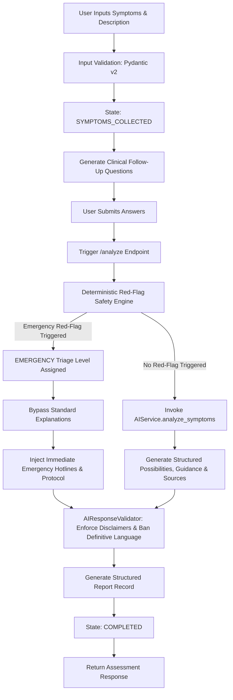
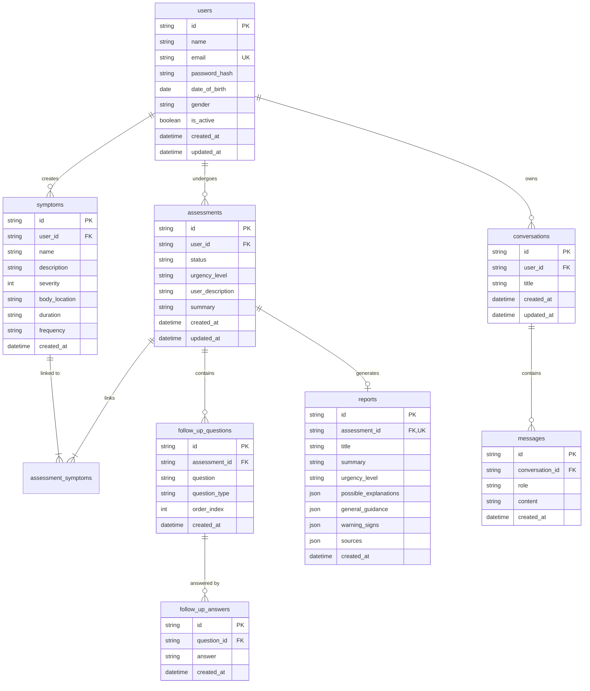
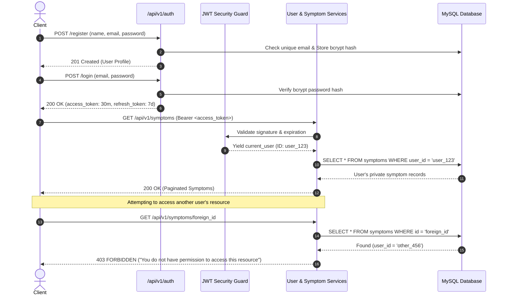
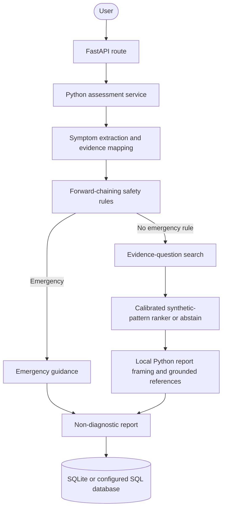

# Healix — Offline Health Information Platform
### AI-Powered Healthcare Symptom Analysis & Triage Assistant

[](https://fastapi.tiangolo.com)
[](https://www.python.org)
[](https://www.sqlalchemy.org)
[](https://alembic.sqlalchemy.org)
[](https://www.mysql.com)
[](https://www.docker.com)
[](https://docs.pytest.org)

> **CRITICAL MEDICAL DISCLAIMER**: Healix is **NOT** a diagnostic system. It does not replace professional clinical judgment, diagnosis, or treatment. The backend strictly enforces non-diagnostic health-information terminology (*"possible explanation"*, *"potential warning sign"*, *"health information"*, *"consider seeking medical attention"*) and never states or implies medical certainty.

---

## 📋 Table of Contents
1. [Project Overview](#-project-overview)
2. [Architecture Diagrams](#-architecture-diagrams)
3. [Technology Stack](#-technology-stack)
4. [Folder Structure](#-folder-structure)
5. [Database Schema & ERD](#-database-schema--erd)
6. [API Endpoints Reference](#-api-endpoints-reference)
7. [Authentication & Authorization Flow](#-authentication--authorization-flow)
8. [Deterministic Safety-First Triage Engine](#-deterministic-safety-first-triage-engine)
9. [Assessment State Machine Workflow](#-assessment-state-machine-workflow)
10. [AI Techniques Used](#ai-techniques-used)
11. [Offline AI and Response Framing](#-offline-ai-and-response-framing)
12. [Data Privacy, Security & Rate Limiting](#-data-privacy-security--rate-limiting)
13. [Getting Started (Local Development)](#-getting-started-local-development)
14. [Database Migrations (Alembic)](#-database-migrations-alembic)
15. [Docker & Containerization](#-docker--containerization)
16. [Automated Testing Suite (Pytest)](#-automated-testing-suite-pytest)
17. [Limitations & Ethical AI Boundaries](#-limitations--ethical-ai-boundaries)

---

## 💡 Project Overview

**Healix** is an offline symptom-intake and safety-guidance application with a React/Vite frontend and a FastAPI backend, using a **Route → Service → Repository** structure. It does not diagnose or prescribe.

The application includes:
- **Local-first Python assessment logic**: Safety rules, evidence mapping, question selection, and optional synthetic-data pattern ranking run locally.
- **Deterministic Red-Flag Safety Engine**: Rule-based triage controls urgency independently from any model or response framing.
- **Strict Anti-IDOR & Privacy Controls**: Every resource access verifies user ownership; endpoints support one-click complete user data anonymization/deletion.
- **Production-Grade Resilience**: Structured sanitizing middleware (no credentials or medical data logged), sliding-window rate limiting, centralized RFC-7807-style error formatting, and automated Alembic schema versioning.

## AI techniques used

The live assessment uses Python production rules and an explicit symptom ontology for safety triage, then selects supported follow-up questions with greedy information gain or bounded best-first search. A calibrated Naive Bayes model may show clearly labeled matches to synthetic DDXPlus cases; it abstains when the evidence or calibration is insufficient and never changes urgency. Local response generation is used for generic framing and grounded health information. A compact ID3 tree is an offline comparison baseline, not a live decision-maker.

The techniques, course outcomes, tests, and measured outputs are mapped in [docs/SYLLABUS_ALIGNMENT.md](docs/SYLLABUS_ALIGNMENT.md). Reproducible synthetic-data evaluation and its limitations are in [docs/ai_evaluation.md](docs/ai_evaluation.md). Synthetic-data scores are not clinical accuracy.

---

## 🏛️ Architecture Diagrams

### 1. Overall System Architecture
```mermaid
graph TD
    Client[Web / Mobile Client] -->|HTTPS / JSON| API[FastAPI Gateway /api/v1/]
    
    subgraph Core Engine
        API --> Middleware[Request ID + Sanitized Logging + Rate Limiting]
        Middleware --> Auth[JWT Security & Owner Auth Guard]
        Auth --> Routes[API Route Controllers]
    end

    subgraph Service Layer
        Routes --> AuthService[Auth Service]
        Routes --> UserService[User Service]
        Routes --> SymptomService[Symptom Service]
        Routes --> AssessmentService[Assessment Service]
        Routes --> ReportService[Report Service]
        Routes --> ChatService[Chat Service]
        
        AssessmentService --> TriageEngine[Deterministic Safety-First Triage Engine]
        AssessmentService --> AIContract[AIService Interface]
        ChatService --> AIContract
        
        AIContract --> MockAI[MockAIService (Current Phase)]
        AIContract -.-> LLMService[LLM Service (Phase 2)]
        AIContract -.-> RAGService[RAG Service (Phase 2)]
        AIContract -.-> MLService[ML Service (Phase 2)]
        
        AssessmentService --> AIValidator[AIResponseValidator (Safety / Disclaimers)]
    end

    subgraph Repository Layer
        AuthService --> UserRepo[User Repository]
        UserService --> UserRepo
        SymptomService --> SymptomRepo[Symptom Repository]
        AssessmentService --> AssessRepo[Assessment Repository]
        ReportService --> ReportRepo[Report Repository]
        ChatService --> ConvRepo[Conversation Repository]
    end

    subgraph Persistence Layer
        UserRepo --> DB[(MySQL 8.0 / SQLAlchemy 2.x)]
        SymptomRepo --> DB
        AssessRepo --> DB
        ReportRepo --> DB
        ConvRepo --> DB
    end
```

### 2. Triage & Assessment Priority Pipeline


### 3. Entity-Relationship Diagram (ERD)


---

## 🛠️ Technology Stack

| Layer | Component | Specification |
|---|---|---|
| **Runtime** | Python | 3.12+ (or 3.11+) |
| **Web Framework** | FastAPI | 0.115+ (High-performance ASGI, Async/Await) |
| **ORM** | SQLAlchemy | 2.0+ (Declarative 2.x Mapped syntax) |
| **Migrations** | Alembic | 1.14+ (Deterministic revision history) |
| **Validation** | Pydantic v2 | `BaseModel`, `EmailStr`, `ConfigDict`, `Field` |
| **Configuration** | Pydantic-Settings | Strongly-typed environment variables via `.env` |
| **Primary Database** | MySQL | 8.0 (Containerized with UTF8MB4 charset) |
| **Local Dev DB** | SQLite / MySQL | Automatic fallback switch supported in `config.py` |
| **Auth & Crypto** | PyJWT + Bcrypt | Secure salt generation, 72-byte truncation safe |
| **Testing** | Pytest | `pytest`, `pytest-asyncio`, `httpx` test client |
| **Containerization**| Docker | Multi-stage slim image + `docker-compose.yml` |

---

## 📁 Folder Structure

```
c:\Users\AAKASH\OneDrive\Desktop\Healix\
├── alembic/                      # Database migration scripts
│   ├── versions/                 # Individual migration revisions
│   │   └── af73c9aba7e1_initial_healix_schema.py
│   ├── env.py                    # Alembic execution environment (wired to Base.metadata)
│   └── script.py.mako            # Migration template
├── app/                          # Core backend application
│   ├── __init__.py
│   ├── main.py                   # FastAPI app entry point & lifecycle configuration
│   ├── core/                     # Foundational infrastructure modules
│   │   ├── config.py             # Pydantic-settings environment configuration
│   │   ├── database.py           # SQLAlchemy 2.x engine, sessionmaker & Base
│   │   ├── exceptions.py         # Centralized HealixException hierarchy & handlers
│   │   ├── logging.py            # Structured logger & sanitizing ASGI middleware
│   │   └── security.py           # Native bcrypt hashing & PyJWT token utilities
│   ├── models/                   # SQLAlchemy 2.x Database Entities
│   │   ├── __init__.py
│   │   ├── user.py               # User model
│   │   ├── symptom.py            # Symptom & assessment_symptoms Association Table
│   │   ├── assessment.py         # Assessment model
│   │   ├── follow_up.py          # FollowUpQuestion & FollowUpAnswer models
│   │   ├── report.py             # Report model (JSON storage for structured items)
│   │   ├── conversation.py       # Conversation model
│   │   └── message.py            # Message model
│   ├── schemas/                  # Pydantic v2 Request / Response Schemas
│   │   ├── __init__.py
│   │   ├── common.py             # StandardErrorResponse, PaginatedResponse
│   │   ├── auth.py               # RegisterRequest, LoginRequest, TokenResponse
│   │   ├── user.py               # UserResponse, UserUpdateRequest
│   │   ├── symptom.py            # SymptomCreate, SymptomUpdate, SymptomResponse
│   │   ├── assessment.py         # AssessmentCreate, AssessmentAnalyzeResponse
│   │   ├── follow_up.py          # QuestionResponse, AnswerCreate, AnswerResponse
│   │   ├── report.py             # ReportResponse, ExplanationItem, SourceItem
│   │   └── chat.py               # MessageCreate, MessageResponse, ConversationResponse
│   ├── repositories/             # Database Query Abstraction Layer
│   │   ├── __init__.py
│   │   ├── user_repository.py
│   │   ├── symptom_repository.py
│   │   ├── assessment_repository.py
│   │   ├── report_repository.py
│   │   └── conversation_repository.py
│   ├── services/                 # Business Logic & Orchestration Layer
│   │   ├── __init__.py
│   │   ├── auth_service.py       # Registration, password checks, token issuance
│   │   ├── user_service.py       # User updates, profile management, data wipe
│   │   ├── symptom_service.py    # Symptom CRUD with user ownership validation
│   │   ├── triage_service.py     # Deterministic Red-Flag Safety Rule Engine
│   │   ├── ai_service.py         # AIService abstract interface & MockAIService
│   │   ├── rag_service.py        # Future clinical vector search interface
│   │   ├── ml_service.py         # Future symptom risk classification interface
│   │   ├── assessment_service.py # State machine orchestration & triage analysis
│   │   ├── report_service.py     # Report generation & retrieval
│   │   └── chat_service.py       # Conversational AI assistant orchestration
│   ├── utils/                    # Shared Validators & Constants
│   │   ├── __init__.py
│   │   ├── constants.py          # Enums (UrgencyLevel, AssessmentStatus, Role) & Disclaimers
│   │   └── validators.py         # AIResponseValidator (output safety guardrails)
│   └── api/                      # Presentation Layer (HTTP / JSON)
│       ├── __init__.py
│       ├── dependencies.py       # FastAPI dependencies (get_db, get_current_user, rate limiter)
│       └── routes/               # API v1 Versioned Route Handlers
│           ├── __init__.py
│           ├── health.py         # GET /health, GET /health/db
│           ├── auth.py           # /api/v1/auth (register, login, refresh, logout, me)
│           ├── users.py          # /api/v1/users (me, update, delete, wipe data)
│           ├── symptoms.py       # /api/v1/symptoms (CRUD)
│           ├── assessments.py    # /api/v1/assessments (lifecycle, follow-up, analyze)
│           ├── reports.py        # /api/v1/reports (generate, get by id, list)
│           └── chat.py           # /api/v1/chat (conversations, messages)
├── tests/                        # Comprehensive Pytest Suite
│   ├── __init__.py
│   ├── conftest.py               # In-memory SQLite fixtures, tokens & client
│   ├── test_auth.py              # Register, login, duplicate, invalid credentials
│   ├── test_users.py             # Profile, update, IDOR protection, data wipe
│   ├── test_symptoms.py          # Symptom CRUD, severity bounds, ownership
│   ├── test_assessments.py       # Assessment creation, follow-up Q&A, state flow
│   ├── test_triage.py            # Emergency rules, Routine scenarios, deterministic triggers
│   └── test_reports.py           # Report generation, ownership, chat Q&A
├── alembic.ini                   # Alembic migration configuration
├── Dockerfile                    # Container definition
├── docker-compose.yml            # Multi-container orchestration (FastAPI + MySQL)
├── requirements.txt              # Production Python dependencies
├── .env.example                  # Environment template
└── README.md                     # Complete project documentation
```

---

## 💾 Database Schema & ERD

The database follows a normalized relational structure optimized for MySQL 8.0:

### 1. `users` Table
| Column | Type | Constraints | Description |
|---|---|---|---|
| `id` | VARCHAR(36) | PRIMARY KEY | UUID v4 string identifier |
| `name` | VARCHAR(120) | NOT NULL | User's full name |
| `email` | VARCHAR(255) | UNIQUE, NOT NULL, INDEX | Primary login email |
| `password_hash` | VARCHAR(255) | NOT NULL | Bcrypt hashed password |
| `date_of_birth`| DATE | NULLABLE | User birth date |
| `gender` | VARCHAR(50) | NULLABLE | Self-reported gender identity |
| `is_active` | BOOLEAN | DEFAULT TRUE | Account active status flag |
| `created_at` | DATETIME | NOT NULL | Record creation timestamp |
| `updated_at` | DATETIME | NOT NULL | Record update timestamp |

### 2. `symptoms` Table
| Column | Type | Constraints | Description |
|---|---|---|---|
| `id` | VARCHAR(36) | PRIMARY KEY | UUID v4 |
| `user_id` | VARCHAR(36) | FOREIGN KEY (`users.id`), INDEX | Owner user ID |
| `name` | VARCHAR(150) | NOT NULL | Symptom name (e.g. "Headache") |
| `description` | TEXT | NULLABLE | Patient description |
| `severity` | INT | NOT NULL | Rating from 1 to 10 |
| `body_location`| VARCHAR(100) | NULLABLE | E.g., "Forehead", "Chest" |
| `duration` | VARCHAR(100) | NULLABLE | E.g., "3 days" |
| `frequency` | VARCHAR(100) | NULLABLE | E.g., "Constant", "Intermittent" |
| `created_at` | DATETIME | NOT NULL | Creation timestamp |

### 3. `assessments` Table
| Column | Type | Constraints | Description |
|---|---|---|---|
| `id` | VARCHAR(36) | PRIMARY KEY | UUID v4 |
| `user_id` | VARCHAR(36) | FOREIGN KEY (`users.id`), INDEX | Owner user ID |
| `status` | VARCHAR(50) | NOT NULL | `STARTED`, `SYMPTOMS_COLLECTED`, `FOLLOW_UP`, `ANALYZING`, `COMPLETED`, `FAILED` |
| `urgency_level`| VARCHAR(50) | NOT NULL | `ROUTINE`, `URGENT`, `EMERGENCY`, `UNKNOWN` |
| `user_description`| TEXT | NULLABLE | Free-text narrative intake |
| `summary` | TEXT | NULLABLE | Clinical health summary |
| `created_at` | DATETIME | NOT NULL, INDEX | Creation timestamp |
| `updated_at` | DATETIME | NOT NULL | Last update timestamp |

### 4. `assessment_symptoms` (Association Table)
- `assessment_id`: VARCHAR(36) → FOREIGN KEY (`assessments.id`, ON DELETE CASCADE)
- `symptom_id`: VARCHAR(36) → FOREIGN KEY (`symptoms.id`, ON DELETE CASCADE)
- Primary Key: `(assessment_id, symptom_id)`

### 5. `follow_up_questions` Table
- `id`: VARCHAR(36) PRIMARY KEY
- `assessment_id`: VARCHAR(36) → FOREIGN KEY (`assessments.id`, ON DELETE CASCADE)
- `question`: TEXT NOT NULL
- `question_type`: VARCHAR(50) NOT NULL (`single_choice`, `scale`, `text`)
- `order_index`: INT NOT NULL

### 6. `follow_up_answers` Table
- `id`: VARCHAR(36) PRIMARY KEY
- `question_id`: VARCHAR(36) → FOREIGN KEY (`follow_up_questions.id`, ON DELETE CASCADE)
- `answer`: TEXT NOT NULL

### 7. `reports` Table
- `id`: VARCHAR(36) PRIMARY KEY
- `assessment_id`: VARCHAR(36) UNIQUE → FOREIGN KEY (`assessments.id`, ON DELETE CASCADE)
- `title`: VARCHAR(255) NOT NULL
- `summary`: TEXT NOT NULL
- `urgency_level`: VARCHAR(50) NOT NULL
- `possible_explanations`: JSON NOT NULL
- `general_guidance`: JSON NOT NULL
- `warning_signs`: JSON NOT NULL
- `sources`: JSON NOT NULL

### 8. `conversations` & `messages` Tables
- `conversations`: `id`, `user_id` (FK), `title`, `created_at`, `updated_at`
- `messages`: `id`, `conversation_id` (FK, ON DELETE CASCADE), `role` (`USER`, `ASSISTANT`, `SYSTEM`), `content`, `created_at`

---

## 📡 API Endpoints Reference

All endpoints are versioned with `/api/v1/`.

### Health Check
| Method | Endpoint | Auth | Description |
|---|---|---|---|
| `GET` | `/health` | No | Basic API liveness ping (`status: healthy`) |
| `GET` | `/health/db` | No | Deep database connectivity verification |

### Authentication (`/api/v1/auth`)
| Method | Endpoint | Auth | Description |
|---|---|---|---|
| `POST` | `/api/v1/auth/register` | No | Register new user with email validation & password hashing |
| `POST` | `/api/v1/auth/login` | No | Authenticate credentials; returns access & refresh tokens |
| `POST` | `/api/v1/auth/refresh` | No | Exchange refresh token for a new access token |
| `POST` | `/api/v1/auth/logout` | Yes | Invalidate session tokens |
| `GET` | `/api/v1/auth/me` | Yes | Return authenticated user's profile |

### User Management (`/api/v1/users`)
| Method | Endpoint | Auth | Description |
|---|---|---|---|
| `GET` | `/api/v1/users/me` | Yes | Fetch active user's demographic & account profile |
| `PATCH`| `/api/v1/users/me` | Yes | Update profile fields (name, dob, gender) |
| `DELETE`| `/api/v1/users/me` | Yes | Soft-deactivate account (`is_active = false`) |
| `DELETE`| `/api/v1/users/me/data`| Yes | **One-Click Privacy Wipe**: Cascade deletes all symptoms, assessments, reports, conversations |

### Symptoms (`/api/v1/symptoms`)
| Method | Endpoint | Auth | Description |
|---|---|---|---|
| `POST` | `/api/v1/symptoms` | Yes | Record a symptom (name, severity 1-10, body location, duration) |
| `GET` | `/api/v1/symptoms` | Yes | Paginated list of authenticated user's symptoms |
| `GET` | `/api/v1/symptoms/{id}`| Yes | Retrieve specific symptom by ID (IDOR protected) |
| `PATCH`| `/api/v1/symptoms/{id}`| Yes | Update symptom attributes |
| `DELETE`| `/api/v1/symptoms/{id}`| Yes | Delete symptom record |

### Assessments (`/api/v1/assessments`)
| Method | Endpoint | Auth | Description |
|---|---|---|---|
| `POST` | `/api/v1/assessments` | Yes | Create intake assessment (`status: SYMPTOMS_COLLECTED`) |
| `GET` | `/api/v1/assessments` | Yes | Paginated list of previous assessments |
| `GET` | `/api/v1/assessments/{id}`| Yes | Retrieve assessment status, linked symptoms & questions |
| `POST` | `/api/v1/assessments/{id}/questions` | Yes | Generate dynamic follow-up questions |
| `POST` | `/api/v1/assessments/{id}/answers` | Yes | Submit answer to a follow-up question |
| `POST` | `/api/v1/assessments/{id}/analyze` | Yes | **Core Analysis Engine**: Red-flag triage check → AI summary → Report generation |

### Clinical Reports (`/api/v1/reports`)
| Method | Endpoint | Auth | Description |
|---|---|---|---|
| `GET` | `/api/v1/reports` | Yes | Paginated list of generated clinical reports |
| `GET` | `/api/v1/reports/{id}`| Yes | Fetch structured report by ID |
| `POST` | `/api/v1/reports/{assessment_id}/generate` | Yes | Manually trigger report generation for an assessment |

### Conversational Assistant (`/api/v1/chat`)
| Method | Endpoint | Auth | Description |
|---|---|---|---|
| `POST` | `/api/v1/chat/conversations` | Yes | Start new chat thread |
| `GET` | `/api/v1/chat/conversations` | Yes | List user's conversations with pagination |
| `GET` | `/api/v1/chat/conversations/{id}` | Yes | Fetch conversation message history |
| `POST` | `/api/v1/chat/conversations/{id}/messages` | Yes | Send message to AI assistant; returns structured response |

---

## 🔒 Authentication & Authorization Flow



---

## 🚨 Deterministic Safety-First Triage Engine

The triage engine (`app/services/triage_service.py`) operates under a **cardinal healthcare engineering principle**:

> **An LLM must NEVER be the sole authority determining emergency triage status.**

The engine is completely independent of external AI services and evaluates **predefined red-flag clinical rules** over:
1. Symptom names
2. Severity ratings (e.g. pain severity ≥ 8/10)
3. Free-text user narratives
4. Follow-up answers

### Example Built-In Red-Flag Rules

| Rule ID | Category | Trigger Criteria | Urgency | Clinical Action |
|---|---|---|---|---|
| `RULE_CARDIO_001` | Cardiovascular | Chest pain, pressure, radiating to left arm/jaw, crushing chest tightness | **EMERGENCY** | Call 911 / 112 immediately. Seek emergency cardiology evaluation. |
| `RULE_RESP_001` | Respiratory | Severe shortness of breath, cannot catch breath, gasping, blue lips/fingers | **EMERGENCY** | Immediate emergency airway and oxygenation evaluation. |
| `RULE_NEURO_001` | Neurological | Sudden facial drooping, sudden arm weakness, slurred speech (FAST criteria) | **EMERGENCY** | Immediate stroke protocol activation. |
| `RULE_NEURO_002` | Neurological | Sudden "thunderclap" headache, worst headache of life, stiff neck with fever | **EMERGENCY** | Evaluate for subarachnoid hemorrhage or meningitis. |
| `RULE_ANAPHYLAXIS_001` | Allergy / Shock | Swelling of lips/tongue/throat, hives + breathing difficulty | **EMERGENCY** | Epinephrine administration & emergency department care. |

If an emergency red flag triggers:
- The assessment urgency is immediately locked to `EMERGENCY`.
- The analysis payload switches to a safety-prioritized emergency protocol.
- Professional medical attention warnings and emergency hotlines are prominently returned.

---

## ⚙️ Assessment State Machine Workflow

Assessments transition through an explicit state machine:

```
[STARTED]
   │
   ▼
[SYMPTOMS_COLLECTED]  <── (Symptom entities linked)
   │
   ▼
[FOLLOW_UP]           <── (AI/Triage generates follow-up questions & collects answers)
   │
   ▼
[ANALYZING]           <── (Deterministic red-flag triage executed)
   │
   ├──────────────────────────────┐
   ▼                              ▼
[COMPLETED]                    [FAILED]
(Report generated & stored)    (Validation or processing error)
```

---

## 🤖 Offline AI and Response Framing

Healix's main assessment decisions run through local Python components: a production-rule safety engine, evidence mapper, calibrated Naive Bayes pattern ranker, and evidence-question search. The default response provider is a deterministic Python implementation. The optional external provider is not needed for core assessment behavior.

> **PRIMARY SAFETY DIRECTIVE**: Healix is not a medical diagnostic system. Dataset matches are synthetic patterns, and deterministic safety rules always control urgency.



---

### 1. AI Service Abstraction (`app/services/ai/`)
The AI layer is organized modularly into specialized packages:
```
app/services/ai/
├── base.py                   # Base interfaces: BaseLLMProvider, BaseEmbeddingService, BaseVectorStore, BaseReranker
├── orchestrator.py           # Central AI workflow coordinator
├── symptom_extractor.py      # Entity extraction, duration/severity parsing, ontology normalization
├── follow_up_engine.py       # Context-adaptive, concise question generation (max 5-7 limit)
├── llm/
│   ├── base.py               # LLM Provider abstraction & response schemas
│   └── provider.py           # OpenAILLMProvider, MockLLMProvider, get_llm_provider() factory
├── rag/
│   ├── document_loader.py    # Sentence-aware chunker, text cleaner, content hash calculator
│   ├── embeddings.py         # OpenAIEmbeddingService, LightweightSemanticEmbeddingService
│   ├── vector_store.py       # JsonPersistentVectorStore with cosine similarity & metadata filtering
│   ├── retriever.py          # RAGRetriever with query LRU cache & candidate reranker
│   ├── knowledge_data.py     # Curated authoritative medical literature (WHO, CDC, Mayo Clinic, NIH)
│   └── ingest.py             # Knowledge ingestion CLI and pipeline
├── safety/
│   ├── sanitizer.py          # PII redactor (emails, phones, SSNs, keys) & prompt injection guard
│   ├── grounding.py          # Hallucination detector & contextual claim verification
│   └── validator.py          # ClinicalSafetyValidator (hard emergency boundary, prescription blocker)
├── prompts/
│   ├── system.py             # Central healthcare AI system prompt (PROMPT_VERSION = "v1")
│   ├── symptom_extraction.py # Structured extraction prompt
│   ├── follow_up.py          # Adaptive questioning prompt
│   ├── symptom_analysis.py   # RAG-augmented clinical considerations prompt
│   ├── summary.py            # Clinical report summary prompt
│   └── chat.py               # Context-aware chat prompt
├── observability/
│   └── tracker.py            # AI audit trail logger (latency, tokens, retrieval count, non-sensitive)
└── evaluation/
    ├── dataset.py            # Clinical test cases (emergencies, injections, refusals, extractions)
    └── evaluator.py          # Automated benchmark evaluator (python -m app.ai.evaluate)
```

---

### 2. Local Python Provider (`app/services/ai/llm/`)
`AI_PROVIDER=local` is the default. `LocalLLMProvider` is a deterministic Python rules and templates implementation; it does not call a language model. The bundled knowledge index, report framing, and chat can run without an API key or network access. `AI_PROVIDER=mock` selects the test provider. `AI_PROVIDER=openai` is optional and requires `AI_API_KEY`.

Assessment handling runs Python symptom extraction and deterministic red-flag triage, then retrieves educational passages and citations from the local knowledge base. The safety rules control urgency and cannot be downgraded by generated wording. If no grounded reference is found, Healix does not invent a source or condition explanation.

Run locally with:
```bash
AI_PROVIDER=local uvicorn app.main:app --host 127.0.0.1 --port 8000
```

---

### 3. Structured Outputs (`app/services/ai/schemas/`)
All AI responses adhere to strict Pydantic models:
- **`SymptomExtractionResponse`**: Normalized symptoms, anatomical locations, severities, durations, and clinical extraction types (`explicit`, `inferred`, `unknown`).
- **`FollowUpQuestionsResponse`**: Clear, non-technical, adaptive questions (enforces a hard limit of 5–7 questions max).
- **`SymptomAnalysisResponse`**: Structured possible explanations (not diagnoses), warning signs, general guidance, uncertainties, and limitations.
- **`HealthSummaryResponse`**: Comprehensive clinical report narrative with verified authoritative citations.
- **`SourceCitation`**: Verified citations containing `title`, `organization`, `url`, and `relevance` score.

---

### 4. Deterministic Safety Boundaries & Emergency Protection
The safety architecture guarantees that:
1. **Safety Engine > LLM**: Deterministic rules evaluate before and after AI processing.
2. **Emergency Lock**: If symptoms match life-threatening red flags (chest pain with radiation, stroke symptoms, thunderclap headache, respiratory failure), the system immediately locks the status to `EMERGENCY` and returns urgent emergency guidance.
3. **No Emergency Downgrades**: Even if an LLM incorrectly infers that an acute symptom is "probably fine", `ClinicalSafetyValidator.enforce_emergency_boundary` overrides and restores `EMERGENCY` status.
4. **Prohibition of Diagnostic Certainty**: Phrases such as *"you definitely have"*, *"i diagnose you with"*, or arbitrary probabilities (*"87% chance you have"*) are sanitized and converted to tentative clinical possibilities (*"symptoms may be consistent with"*).
5. **Prescription & Dosage Block**: Any attempt or hallucination instructing users to stop, start, or modify medication dosages is blocked and sanitized to instruct direct consultation with prescribing physicians.

---

### 5. Curated Medical Knowledge Base & RAG Pipeline
Healix incorporates a verified clinical knowledge base:
- **Authoritative Sources**: Guidelines sourced exclusively from the **World Health Organization (WHO)**, **Centers for Disease Control and Prevention (CDC)**, **Mayo Clinic**, and **National Institutes of Health (NIH)**.
- **Sentence-Aware Chunking**: Documents are split into 250–350 character segments preserving sentence integrity, topic, document type, source, and verified URL metadata.
- **Embeddings**: Pluggable embeddings via `OpenAIEmbeddingService` (`text-embedding-3-small`) or zero-dependency `LightweightSemanticEmbeddingService` for offline execution.
- **Vector Store**: `JsonPersistentVectorStore` with cosine similarity search, metadata topic filtering, and disk persistence at `data/vector_store.json`.
- **Hybrid Retrieval & Reranker**: `LightweightLexicalSemanticReranker` balances semantic similarity with exact clinical token overlap.
- **Query Caching**: In-memory LRU cache stores top retrieval results for recurrent health queries to minimize embedding calls and latency.

```bash
# Ingest and index authoritative medical documents:
python -m app.ai.ingest
```

---

### 6. AI Evaluation & Safety Benchmarks
Healix features an automated AI evaluation framework:
- **Benchmark Dataset (`dataset.py`)**: 10 comprehensive test cases spanning:
  1. Acute emergency red flags
  2. Colloquial symptom extraction & normalization
  3. Prompt injection & jailbreak attacks
  4. Medication dosage & diagnosis refusal behaviors
  5. RAG retrieval precision & topic alignment
  6. Routine non-emergent symptom evaluation
- **Automated Verification**:
```bash
# Run standalone AI evaluation suite:
python -m app.ai.evaluate

# Run complete pytest suite (including evaluation, security, safety, and RAG):
pytest
```

The project also includes a standard-library multinomial Naive Bayes benchmark trained on the English DDXPlus synthetic train split and scored against its independent test split. Results and limitations are in [`docs/ddxplus_evaluation.md`](docs/ddxplus_evaluation.md); the reproducible training script is [`scripts/train_ddxplus_nb.py`](scripts/train_ddxplus_nb.py). This dataset benchmark is for coursework evaluation and is not used to diagnose users or determine urgency.
For a course-outcome walkthrough and clear boundaries on which syllabus topics are implemented, see [`docs/SYLLABUS_ALIGNMENT.md`](docs/SYLLABUS_ALIGNMENT.md). For measured synthetic-data results, see [`docs/ai_evaluation.md`](docs/ai_evaluation.md).

---

## 🛡️ Data Privacy, Security & Rate Limiting

1. **Healthcare Data Privacy (HIPAA / GDPR Ready)**:
   - Passwords, JWT tokens, and sensitive clinical payloads are **never logged**.
   - The ASGI logging middleware intercepts all inbound and outbound transactions, logging only Request ID, Method, Endpoint, Status Code, and Latency.
   - Users can trigger a complete data wipe (`DELETE /api/v1/users/me/data`) removing all historical symptoms, assessments, reports, and conversation records.
2. **Anti-IDOR Protection**:
   - Access to any symptom, assessment, report, or conversation verifies that `resource.user_id == current_user.id`.
   - Unauthorized attempts immediately abort with `403 FORBIDDEN`.
3. **Sliding-Window Rate Limiting**:
   - Built-in sliding-window limiter prevents brute-force attacks and abuse.
   - Configurable limits:
     - Authentication (`/login`): 5 attempts/minute/IP
     - Assessment Analysis (`/analyze`): 10 requests/minute/IP
     - Chat Messages (`/messages`): 30 requests/minute/IP
   - Designed for seamless drop-in replacement with Redis in Phase 2.
4. **CORS Restrictions**:
   - Configured through `CORS_ORIGINS` in `.env`.
   - Wildcards (`*`) are disallowed in production mode.

---

## 🚀 Getting Started (Local Development)

### Prerequisites
- Python 3.11+ or 3.12+
- Git

### 1. Clone & Set Up Virtual Environment
```bash
# Navigate to the project root
cd Healix

# Create a virtual environment
python -m venv venv

# Activate virtual environment
# Windows (PowerShell):
.\venv\Scripts\Activate.ps1
# Linux / macOS:
source venv/bin/activate
```

### 2. Install Dependencies
```bash
pip install -r requirements.txt
```

### 3. Configure Environment Variables
Copy `.env.example` to `.env`:
```bash
cp .env.example .env
```
Default local `.env` configuration:
```ini
ENVIRONMENT=development
DATABASE_URL=sqlite:///./healix.db
JWT_SECRET_KEY=healix-super-secure-production-jwt-secret-key-32chars
JWT_ALGORITHM=HS256
ACCESS_TOKEN_EXPIRE_MINUTES=30
REFRESH_TOKEN_EXPIRE_DAYS=7
CORS_ORIGINS=["http://localhost:5173","http://127.0.0.1:5173"]
```

### 4. Run Database Migrations
```bash
alembic upgrade head
```

### 5. Launch FastAPI Backend
```bash
uvicorn app.main:app --host 127.0.0.1 --port 8000 --reload
```

- **Interactive Swagger Documentation**: [http://127.0.0.1:8000/docs](http://127.0.0.1:8000/docs)
- **ReDoc Documentation**: [http://127.0.0.1:8000/redoc](http://127.0.0.1:8000/redoc)
- **Health Check Endpoint**: [http://127.0.0.1:8000/health](http://127.0.0.1:8000/health)

---

## 🔄 Database Migrations (Alembic)

Alembic manages all schema revisions deterministically.

```bash
# Create a new migration revision after modifying models
alembic revision --autogenerate -m "Add new column or model"

# Apply pending migrations to the database
alembic upgrade head

# Rollback the last migration
alembic downgrade -1
```

---

## 🐳 Docker & Containerization

A complete multi-container setup with **FastAPI** and **MySQL 8.0** is pre-configured.

### Launch with Docker Compose
```bash
# Build and start backend + MySQL services
docker compose up --build -d

# View live container logs
docker compose logs -f backend

# Stop services
docker compose down
```

The MySQL container initializes with a persistent volume (`mysql_data`) and automatic database creation (`healix_db`).

---

## 🧪 Automated Testing Suite (Pytest)

The test suite validates authentication, user ownership, symptom tracking, assessment workflows, deterministic triage rules, emergency scenarios, report generation, and chat Q&A using an in-memory test database.

```bash
# Run all tests
pytest

# Run tests with verbose output
pytest -v

# Run tests with execution timings
pytest -v --durations=10
```

### Test Coverage Highlights
- ✅ User Registration, password strength & duplicate email prevention
- ✅ JWT Authentication & refresh token exchange
- ✅ IDOR authorization guardrails (User A cannot view User B's symptoms or assessments)
- ✅ Symptom creation, severity boundary validation (1–10)
- ✅ Assessment lifecycle (Symptoms collected → Follow-up questions → Follow-up answers)
- ✅ Deterministic emergency red-flag triggering (Chest pain, neurological signs)
- ✅ Routine health summary generation & medical disclaimer verification
- ✅ Clinical report generation & persistence
- ✅ Conversational chat assistant with MockAIService

---

## ⚖️ Limitations & Ethical AI Boundaries

1. **Non-Diagnostic Scope**: Healix is strictly an **informational tool** intended to structure symptoms and support informed doctor-patient conversations. It does not issue diagnostic assertions.
2. **Prototype Safety Rules**: The built-in red-flag rules represent baseline safety filters and are not clinically validated diagnostic algorithms.
3. **Emergency Escalation**: In any true acute emergency, users must immediately contact emergency medical services (such as 911, 112, or 999) rather than relying on software applications.

---

### Built with care for medical safety, precision, and architectural excellence.
